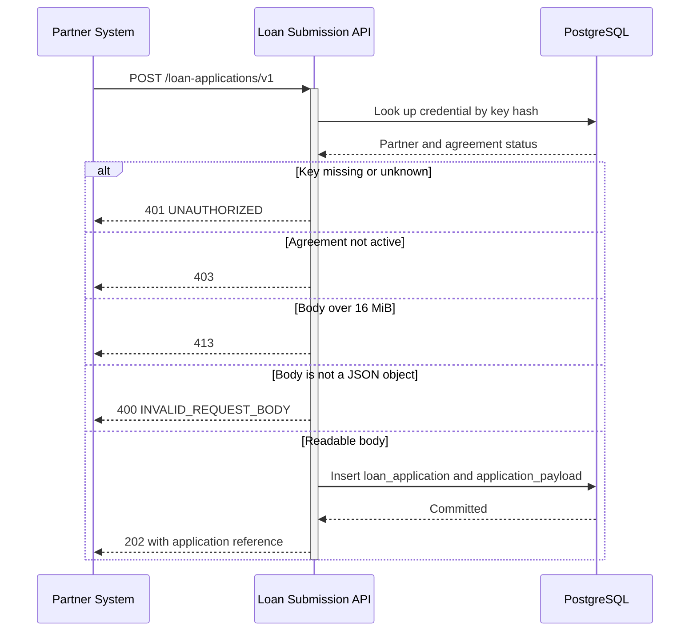
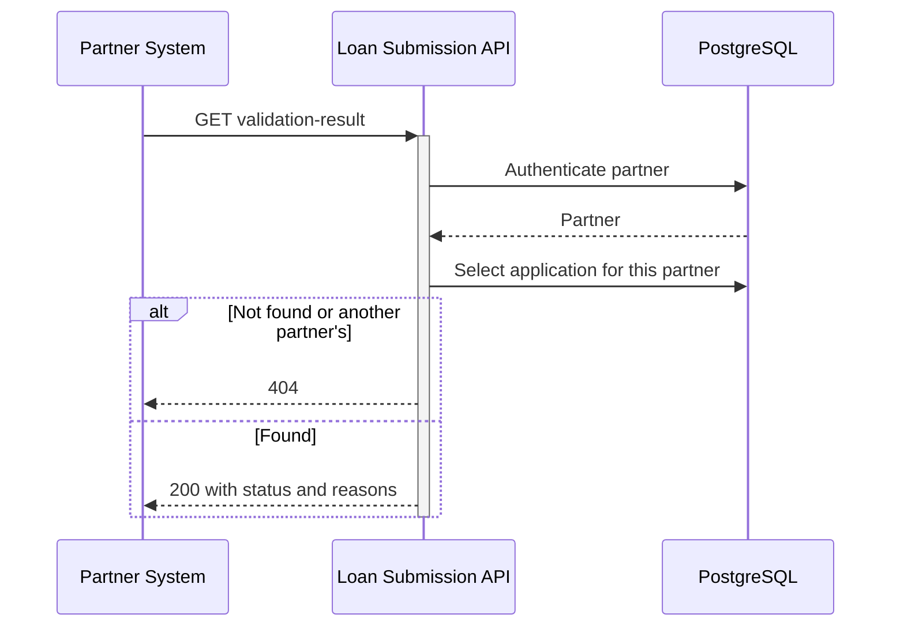
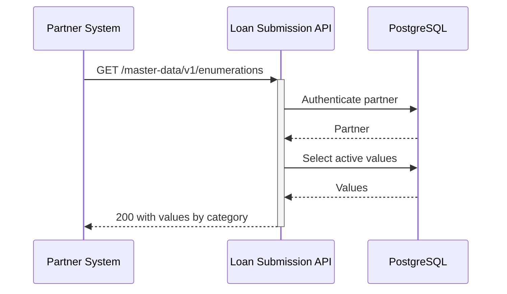
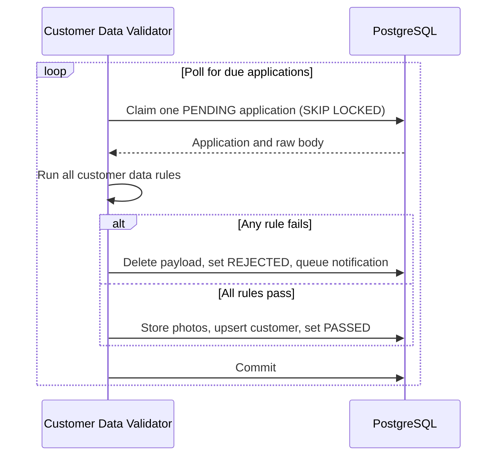
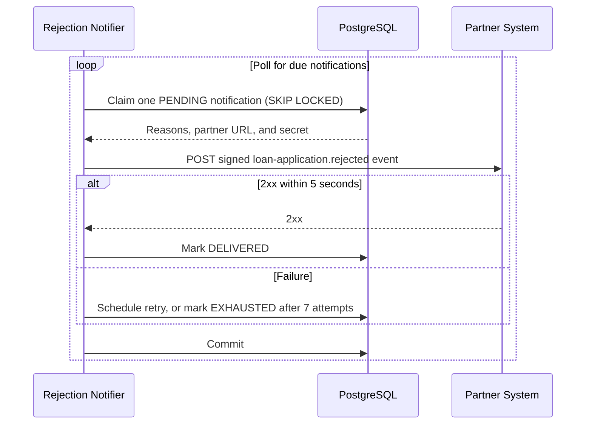

# Technical Design - Submit Loan Application with Customer Data

## Changelog

| Version | Date | Changes |
|---------|------|---------|
| `0.0.1` | 2026-10-31 | - Initial conversion from plan.md. |

## Source Requirement

| ID | Type | Description |
|----|------|-------------|
| [spec.md](spec.md) | Feature Specification | Submit Loan Application with Customer Data |
| [plan.md](plan.md) | Implementation Plan | Implementation plan for feature `001-submit-loan-customer-data` |

## Scope

- A contracted partner submits a loan application with customer data. The API records the raw submission and acknowledges it with an application reference within 2 seconds.
- A background worker in the same service validates the customer data after acknowledgment. Validation never runs in the request-response cycle (Constitution Principle III).
- On failure, the worker deletes the personal data and photos, keeps a minimal Rejected record, and queues a signed webhook to the partner.
- Partners can read the validation result by application reference, and can list accepted customer values.
- PostgreSQL is both the record store and the work queue (`FOR UPDATE SKIP LOCKED`), so no new infrastructure or libraries are added.
- The request path checks only authentication, an active agreement, the 16 MiB body limit, and that the body is a JSON object. A body that can't be read can't become a record.
- The service is bootstrapped from `jmlane8/rest-api-template` at commit `147b01094598a24d01e59a214f538707c5369b03`, using Go 1.26 and PostgreSQL 16+.
- Targets: 100% of recorded submissions acknowledged within 2 seconds, and 95% validated within 1 minute of acknowledgment.

**Out of scope**

- Partner key issuing, revoking and rotation, and registering a notification address (US-001 owns the credential lifecycle).
- Spouse data (US-003), collateral validation (US-004), loan terms (US-005), coverage area (US-006), and resubmission checks (US-007). Collateral and loan sections are stored but not validated.
- Risk scoring handoff (US-008) and loan decisions. "Passed" means customer data only.
- Tracking of loan decisions through the lookup.
- Submission volume limits (AC-001-004 forbids them).
- Idempotency keys. A retried `POST` creates a new application.

---

## API Design

### `/loan-applications/v1`

**Verb**: `POST` <br>
**Path**: `/loan-applications/v1` <br>
**Authentication**: Custom HTTP Header (`api-key`) <br>
**Produces**: `application/json` <br>
**Consumes**: `application/json` <br>

#### Path variables

None

#### Query parameters

None

#### Request Schema

Mandatory fields are not enforced by this endpoint. A missing or invalid field still gets `202`, and is reported after acknowledgment through the rejection webhook and the validation result lookup. The body limit is 16 MiB.

**Schema**
```
{
  "customer": {
    "government-id-photo": string,        // [mandatory] Base64 JPEG or PNG, at most 5 MiB decoded and 50 megapixels
    "government-id-expiry-date": string,  // [mandatory] Real date, YYYY-MM-DD, not before the submission date
    "national-id-number": string,         // [mandatory] Letters and digits only
    "full-legal-name": string,            // [mandatory]
    "selfie-photo": string,               // [mandatory] Base64 JPEG or PNG, at most 5 MiB decoded and 50 megapixels
    "phone-number": string,               // [mandatory] Use regex ^\+?\d{8,15}$
    "email": string,                      // [optional] Never a rejection reason
    "gender": string,                     // [mandatory] Active GENDER value from /master-data/v1/enumerations
    "date-of-birth": string,              // [mandatory] Real date, YYYY-MM-DD. Customer must be 18 on the submission date
    "place-of-birth": string,             // [mandatory]
    "marital-status": string,             // [mandatory] One of (SINGLE | MARRIED | DIVORCED | WIDOWED), case sensitive
    "occupation": string,                 // [mandatory] One of (EMPLOYEE | ENTREPRENEUR | CIVIL_SERVANT), case sensitive
    "work-duration-years": number,        // [mandatory] Whole number, 0 to 32767
    "monthly-income": number,             // [mandatory] Greater than 0, up to 18 whole digits and 2 decimals
    "number-of-dependents": number,       // [mandatory] Whole number, 0 to 32767
    "domicile-street": string,            // [mandatory]
    "domicile-district": string,          // [mandatory]
    "domicile-city": string,              // [mandatory]
    "domicile-province": string           // [mandatory]
  },
  "collateral": object,                   // [optional] Defined by US-004. Stored, not validated by this feature
  "loan": object                          // [optional] Defined by US-005. Stored, not validated by this feature
}
```

**Example**

```json
{
  "customer": {
    "government-id-photo": "/9j/4AAQSkZJRgABAQ...",
    "government-id-expiry-date": "2030-05-14",
    "national-id-number": "3201012345678901",
    "full-legal-name": "Alex Morgan",
    "selfie-photo": "/9j/4AAQSkZJRgABAQ...",
    "phone-number": "+15551234567",
    "email": "alex@example.com",
    "gender": "FEMALE",
    "date-of-birth": "1990-02-11",
    "place-of-birth": "Springfield",
    "marital-status": "SINGLE",
    "occupation": "EMPLOYEE",
    "work-duration-years": 6,
    "monthly-income": 4500.5,
    "number-of-dependents": 1,
    "domicile-street": "12 Example Street",
    "domicile-district": "Central",
    "domicile-city": "Springfield",
    "domicile-province": "North"
  },
  "collateral": {},
  "loan": {}
}
```

#### Response Schema

**Schema for 202 Accepted**
```
{
  "data": {
    "application-reference": string,  // LA- followed by the application's UUIDv7
    "submitted-at": string            // RFC 3339 timestamp
  }
}
```

**Example for 202 Accepted**
```json
{
  "data": {
    "application-reference": "LA-019a3b1c-7d2e-7f10-9c44-2b6e1f0a8d11",
    "submitted-at": "2026-10-31T04:15:02Z"
  }
}
```

**Schema for 400, 401, 403, 413, and 500**
```
{
  "error-code": string,    // machine-readable error identifier
  "error-message": string  // human-readable description of the error
}
```

**Example for 401 Unauthorized**
```json
{
  "error-code": "UNAUTHORIZED",
  "error-message": "unauthorized: invalid or missing api-key"
}
```

#### Non-2xx Error Registry

| HTTP Status | Error Code | Scenario | Retryable |
|-------------|------------|----------|-----------|
| 400 | INVALID_REQUEST_BODY | Body is not a JSON object. No application recorded | NO |
| 401 | UNAUTHORIZED | `api-key` is missing or unknown, or the credential is not valid | NO |
| 403 | TODO: error code | Valid key, but the partner's agreement is not active | NO |
| 413 | TODO: error code | Body is over 16 MiB. No application recorded | NO |
| 500 | INTERNAL_SERVER_ERROR | Storage or unexpected server error. No application recorded | YES |

### `/loan-applications/v1/{application-reference}/validation-result`

**Verb**: `GET` <br>
**Path**: `/loan-applications/v1/{application-reference}/validation-result` <br>
**Authentication**: Custom HTTP Header (`api-key`) <br>
**Produces**: `application/json` <br>

#### Path variables

| Parameter | Valid value |
|-----------|-------------|
| application-reference | Reference returned in the acknowledgment, belonging to the calling partner |

#### Query parameters

None

#### Request Schema

None

#### Response Schema

**Schema for 200 OK**
```
{
  "data": {
    "application-reference": string,
    "status": string,            // One of (PENDING | PASSED | REJECTED)
    "submitted-at": string,      // RFC 3339 timestamp
    "validated-at": string,      // RFC 3339 timestamp, null while PENDING
    "reasons": [                 // [optional] Present only when status is REJECTED
      {
        "field": string,         // Affected field, for example customer.phone-number
        "code": string,          // One of (MISSING | INVALID | CUSTOMER_UNDER_AGE | GOVERNMENT_ID_EXPIRED)
        "message": string        // Never contains submitted values
      }
    ]
  }
}
```

**Example for 200 OK**
```json
{
  "data": {
    "application-reference": "LA-019a3b1c-7d2e-7f10-9c44-2b6e1f0a8d11",
    "status": "REJECTED",
    "submitted-at": "2026-10-31T04:15:02Z",
    "validated-at": "2026-10-31T04:15:09Z",
    "reasons": [
      {
        "field": "customer.phone-number",
        "code": "INVALID",
        "message": "phone-number must be an optional + followed by 8 to 15 digits"
      }
    ]
  }
}
```

**Schema for 401, 403, 404, and 500**
```
{
  "error-code": string,    // machine-readable error identifier
  "error-message": string  // human-readable description of the error
}
```

**Example for 401 Unauthorized**
```json
{
  "error-code": "UNAUTHORIZED",
  "error-message": "unauthorized: invalid or missing api-key"
}
```

#### Non-2xx Error Registry

| HTTP Status | Error Code | Scenario | Retryable |
|-------------|------------|----------|-----------|
| 401 | UNAUTHORIZED | `api-key` is missing or unknown, or the credential is not valid | NO |
| 403 | TODO: error code | Valid key, but the partner's agreement is not active | NO |
| 404 | TODO: error code | Reference is unknown or belongs to another partner | NO |
| 500 | INTERNAL_SERVER_ERROR | Storage or unexpected server error | YES |

### `/master-data/v1/enumerations`

**Verb**: `GET` <br>
**Path**: `/master-data/v1/enumerations` <br>
**Authentication**: Custom HTTP Header (`api-key`) <br>
**Produces**: `application/json` <br>

#### Path variables

None

#### Query parameters

None

#### Request Schema

None

#### Response Schema

**Schema for 200 OK**
```
{
  "data": {
    "gender": [string],          // Active GENDER values
    "marital-status": [string],  // Active MARITAL_STATUS values
    "occupation": [string]       // Active OCCUPATION values
  }
}
```

**Example for 200 OK**
```json
{
  "data": {
    "gender": ["MALE", "FEMALE"],
    "marital-status": ["SINGLE", "MARRIED", "DIVORCED", "WIDOWED"],
    "occupation": ["EMPLOYEE", "ENTREPRENEUR", "CIVIL_SERVANT"]
  }
}
```

**Schema for 401, 403, and 500**
```
{
  "error-code": string,    // machine-readable error identifier
  "error-message": string  // human-readable description of the error
}
```

**Example for 401 Unauthorized**
```json
{
  "error-code": "UNAUTHORIZED",
  "error-message": "unauthorized: invalid or missing api-key"
}
```

#### Non-2xx Error Registry

| HTTP Status | Error Code | Scenario | Retryable |
|-------------|------------|----------|-----------|
| 401 | UNAUTHORIZED | `api-key` is missing or unknown, or the credential is not valid | NO |
| 403 | TODO: error code | Valid key, but the partner's agreement is not active | NO |
| 500 | INTERNAL_SERVER_ERROR | Storage or unexpected server error | YES |

---

## Scheduled Task Design

### Customer Data Validator

**Trigger**: Other (polling loop started by the service) <br>
**Schedule**: Continuous polling for due `PENDING` applications. TODO: polling interval <br>
**Timezone**: Schedule is interval based, so None. The submission date is derived using the required `BUSINESS_TIMEZONE` setting <br>
**Concurrency Control**: `SELECT ... FOR UPDATE SKIP LOCKED`, one application per transaction. Several replicas can run safely <br>
**Idempotency**: The row stays locked for the whole transaction. A crash rolls everything back and the row is picked up again, so a result is never half-applied <br>

#### Inputs

| Parameter | Source | Valid value |
|-----------|--------|-------------|
| Pending applications | Database | `application_status = 'PENDING'` and `next_validation_at` is due |
| Raw submission | Database | `application_payload.body` |
| Accepted gender values | Database | Active `GENDER` rows in `master_data_value` |
| `BUSINESS_TIMEZONE` | Environment Variable | Required IANA time zone name. No default; startup fails without it |

#### Processing Steps

1. Claim one due application and lock it.
2. Derive the submission date from `submitted_at` using `BUSINESS_TIMEZONE`.
3. Run every rule, so all problems appear in one rejection.
4. If any rule fails: hard-delete the payload, mark the application `REJECTED` with reasons, and queue a notification.
5. If all rules pass: store the photos, upsert the customer, mark the application `PASSED`, and reduce the payload to its `collateral` and `loan` sections.
6. Commit.

**Validation rules**

| Field (`customer.`) | Rule | Reason code | Requirement |
|---|---|---|---|
| Any mandatory field | Absent, null, or empty or whitespace-only text | `MISSING` | FR-002, FR-004 |
| `marital-status` | Exact accepted value | `INVALID` | FR-005 |
| `occupation` | Exact accepted value | `INVALID` | FR-006 |
| `date-of-birth` | Real date in `YYYY-MM-DD`, not after the submission date | `INVALID` | FR-015 |
| `date-of-birth` | Customer is 18 on the submission date. 29 February births reach 18 on 1 March in non-leap years | `CUSTOMER_UNDER_AGE` | FR-007 |
| `government-id-expiry-date` | Real date in `YYYY-MM-DD` | `INVALID` | FR-015 |
| `government-id-expiry-date` | Not before the submission date | `GOVERNMENT_ID_EXPIRED` | FR-008 |
| `national-id-number` | Letters and digits only | `INVALID` | FR-015 |
| `phone-number` | Optional `+`, then 8 to 15 digits | `INVALID` | FR-015 |
| `gender` | Active `GENDER` master data value | `INVALID` | FR-015 |
| `work-duration-years`, `number-of-dependents` | Whole number, 0 or more, at most 32,767 | `INVALID` | FR-015 |
| `monthly-income` | Greater than 0, plain decimal, up to 18 whole digits and 2 decimals | `INVALID` | FR-015 |
| `government-id-photo`, `selfie-photo` | Base64 JPEG or PNG that fully decodes, at most 5 MiB and 50 megapixels | `INVALID` | FR-015 |
| Any text field | No NUL characters, which PostgreSQL text can't store | `INVALID` | FR-015 |

A field with the wrong JSON type is `INVALID`. A non-text `email` is treated as absent.

#### Outputs / Side Effects

| Output | Description |
|--------|-------------|
| Updated row in `loan_application` | Moves to `PASSED` or `REJECTED`, with `validated_at` set |
| Hard-deleted row in `application_payload` | On rejection, removing all personal data and photos (FR-011) |
| New row in `rejection_notification` | On rejection, when the partner has a `notification_url` |
| New rows in `stored_photo`, upserted row in `customer` | On pass |

#### Failure & Retry Registry

| Failure Scenario | Handling | Retryable | Alerting |
|-------------------|----------|-----------|----------|
| Internal failure while processing an application | Roll back, increment `validation_attempts`, and set a later `next_validation_at`. TODO: backoff schedule | YES | Error log with reference only. TODO: alert target |
| Service crash mid-transaction | Transaction rolls back and the row is claimed again | YES | None |
| Partner has no `notification_url` | Rejection still completes; no notification row is created | NO | Warning log |

### Rejection Notifier

**Trigger**: Other (polling loop started by the service) <br>
**Schedule**: Continuous polling for due `PENDING` notifications. TODO: polling interval <br>
**Timezone**: None <br>
**Concurrency Control**: `SELECT ... FOR UPDATE SKIP LOCKED`, one notification per transaction <br>
**Idempotency**: Delivery is at-least-once. Every attempt carries the same `event-id`, so partners can de-duplicate <br>

#### Inputs

| Parameter | Source | Valid value |
|-----------|--------|-------------|
| Due notifications | Database | `status = 'PENDING'` and `next_attempt_at` is due |
| Rejection details | Database | Reference, `rejected_at`, and `rejection_reasons` from `loan_application` |
| `notification_url`, `notification_secret` | Database | From `partner`. HTTPS required outside `local` |

#### Processing Steps

1. Claim one due notification and lock it.
2. Build the JSON body from the application's reasons. The body contains no submitted values.
3. Sign `<x-timestamp>.<raw body>` with HMAC-SHA256, using the partner's secret.
4. POST to the partner with a 5-second timeout.
5. On any `2xx`, mark it `DELIVERED`. Otherwise record the attempt, then schedule a retry or mark it `EXHAUSTED`.

Delivery details are in [contracts/rejection-webhook.md](contracts/rejection-webhook.md).

#### Outputs / Side Effects

| Output | Description |
|--------|-------------|
| HTTP POST to the partner | Signed `loan-application.rejected` event |
| Updated row in `rejection_notification` | `DELIVERED`, or `attempts` and `next_attempt_at` updated, or `EXHAUSTED` |

#### Failure & Retry Registry

| Failure Scenario | Handling | Retryable | Alerting |
|-------------------|----------|-----------|----------|
| Non-2xx response, timeout, or connection failure | Retry 1 minute, 5 minutes, 30 minutes, 2 hours, 6 hours and 12 hours after the previous attempt | YES | None |
| 7 attempts have failed | Mark `EXHAUSTED`. The partner can still use the validation result lookup | NO | Log entry. TODO: alert target |

---

## Database Design

### Table Definitions

Every table has the standard audit and soft-delete columns from the template, so they aren't repeated in the field tables.

**Exception to the soft-delete rule**: rejected `application_payload` rows are hard-deleted. FR-011 requires personal data and photos to be deleted, and a soft delete would keep them on file. No other delete exists in this design.

#### partner

**Fields**

| Field | Description | Data Type | Mandatory | Notes |
|-------|-------------|-----------|-----------|-------|
| partner_id | Unique identifier of the partner | UUID | Yes | PK |
| agreement_status | Whether the partner's agreement is active | Text | Yes | `ACTIVE` or `INACTIVE` |
| agreement_signed_date | Date the agreement was signed | Date | Yes | |
| notification_url | Address for rejection webhooks | Text | No | HTTPS required outside `local` |
| notification_secret | Secret used to sign webhooks | Text | No | Required when `notification_url` is set |

**Indices**

- Primary key on `partner_id`

**DDL**

```sql
CREATE TABLE partner (
    partner_id            UUID        NOT NULL,
    agreement_status      TEXT        NOT NULL CHECK (agreement_status IN ('ACTIVE', 'INACTIVE')),
    agreement_signed_date DATE        NOT NULL,
    notification_url      TEXT,
    notification_secret   TEXT,
    created_at            TIMESTAMPTZ NOT NULL DEFAULT NOW(),
    updated_at            TIMESTAMPTZ NOT NULL DEFAULT NOW(),
    deleted               BOOLEAN     NOT NULL DEFAULT FALSE,
    deleted_at            TIMESTAMPTZ DEFAULT NULL,
    created_by            TEXT        NOT NULL DEFAULT 'system',
    updated_by            TEXT        NOT NULL DEFAULT 'system',
    deleted_by            TEXT        DEFAULT NULL,
    CONSTRAINT partner_pkey PRIMARY KEY (partner_id),
    CONSTRAINT partner_notification_secret_check
        CHECK (notification_url IS NULL OR notification_secret IS NOT NULL)
);
```

#### partner_credential

**Fields**

| Field | Description | Data Type | Mandatory | Notes |
|-------|-------------|-----------|-----------|-------|
| partner_credential_id | Unique identifier of the credential | UUID | Yes | PK |
| partner_id | Partner that owns the credential | UUID | Yes | FK → partner |
| key_hash | SHA-256 of the API key | Bytes | Yes | Unique |
| is_valid | Whether the credential can authenticate | Boolean | Yes | |
| issued_at | When the credential was provisioned | Timestamp | Yes | Must be after `partner.agreement_signed_date` |

**Indices**

- Primary key on `partner_credential_id`
- Unique index on `key_hash`

**DDL**

```sql
CREATE TABLE partner_credential (
    partner_credential_id UUID        NOT NULL,
    partner_id            UUID        NOT NULL,
    key_hash              BYTEA       NOT NULL,
    is_valid              BOOLEAN     NOT NULL,
    issued_at             TIMESTAMPTZ NOT NULL,
    created_at            TIMESTAMPTZ NOT NULL DEFAULT NOW(),
    updated_at            TIMESTAMPTZ NOT NULL DEFAULT NOW(),
    deleted               BOOLEAN     NOT NULL DEFAULT FALSE,
    deleted_at            TIMESTAMPTZ DEFAULT NULL,
    created_by            TEXT        NOT NULL DEFAULT 'system',
    updated_by            TEXT        NOT NULL DEFAULT 'system',
    deleted_by            TEXT        DEFAULT NULL,
    CONSTRAINT partner_credential_pkey PRIMARY KEY (partner_credential_id),
    CONSTRAINT partner_credential_key_hash_key UNIQUE (key_hash),
    CONSTRAINT partner_credential_partner_fkey
        FOREIGN KEY (partner_id) REFERENCES partner (partner_id)
);

-- CHECK constraints can't read another table, so a trigger enforces this rule.
-- A credential issued later on the signing day passes.
CREATE FUNCTION partner_credential_check_issued_at() RETURNS trigger AS $$
BEGIN
    IF NEW.issued_at <= (SELECT agreement_signed_date
                         FROM partner
                         WHERE partner_id = NEW.partner_id) THEN
        RAISE EXCEPTION 'issued_at must be after agreement_signed_date';
    END IF;
    RETURN NEW;
END;
$$ LANGUAGE plpgsql;

CREATE TRIGGER partner_credential_issued_at_trigger
    BEFORE INSERT OR UPDATE ON partner_credential
    FOR EACH ROW EXECUTE FUNCTION partner_credential_check_issued_at();
```

#### stored_photo

**Fields**

| Field | Description | Data Type | Mandatory | Notes |
|-------|-------------|-----------|-----------|-------|
| photo_id | Unique identifier of the photo | UUID | Yes | PK |
| content_type | Image type | Text | Yes | `image/jpeg` or `image/png` |
| content | Decoded image | Bytes | Yes | |

**Indices**

- Primary key on `photo_id`

**DDL**

```sql
CREATE TABLE stored_photo (
    photo_id     UUID        NOT NULL,
    content_type TEXT        NOT NULL CHECK (content_type IN ('image/jpeg', 'image/png')),
    content      BYTEA       NOT NULL,
    created_at   TIMESTAMPTZ NOT NULL DEFAULT NOW(),
    updated_at   TIMESTAMPTZ NOT NULL DEFAULT NOW(),
    deleted      BOOLEAN     NOT NULL DEFAULT FALSE,
    deleted_at   TIMESTAMPTZ DEFAULT NULL,
    created_by   TEXT        NOT NULL DEFAULT 'system',
    updated_by   TEXT        NOT NULL DEFAULT 'system',
    deleted_by   TEXT        DEFAULT NULL,
    CONSTRAINT stored_photo_pkey PRIMARY KEY (photo_id)
);
```

#### customer

**Fields**

| Field | Description | Data Type | Mandatory | Notes |
|-------|-------------|-----------|-----------|-------|
| customer_id | Unique identifier of the customer | UUID | Yes | PK |
| national_id_number | National ID number | Text | Yes | Unique |
| full_legal_name | Full legal name | Text | Yes | |
| government_id_photo | Photo of the government-issued ID | UUID | Yes | FK → stored_photo |
| government_id_expiry_date | ID expiry date | Date | Yes | |
| selfie_photo | Selfie photo | UUID | Yes | FK → stored_photo |
| phone_number | Phone number | Text | Yes | |
| gender | Gender | Text | Yes | |
| date_of_birth | Date of birth | Date | Yes | |
| place_of_birth | Place of birth | Text | Yes | |
| marital_status | Marital status | Text | Yes | |
| occupation | Occupation | Text | Yes | |
| work_duration_years | Years worked | Number | Yes | `SMALLINT` |
| monthly_income | Monthly income | Number | Yes | `NUMERIC(20,2)` |
| number_of_dependents | Number of dependents | Number | Yes | `SMALLINT` |
| email | Email address | Text | No | |
| domicile_street | Domicile street | Text | Yes | |
| domicile_district | Domicile district | Text | Yes | |
| domicile_city | Domicile city | Text | Yes | |
| domicile_province | Domicile province | Text | Yes | |

**Indices**

- Primary key on `customer_id`
- Unique index on `national_id_number`

**DDL**

```sql
CREATE TABLE customer (
    customer_id               UUID           NOT NULL,
    national_id_number        TEXT           NOT NULL,
    full_legal_name           TEXT           NOT NULL,
    government_id_photo       UUID           NOT NULL,
    government_id_expiry_date DATE           NOT NULL,
    selfie_photo              UUID           NOT NULL,
    phone_number              TEXT           NOT NULL,
    gender                    TEXT           NOT NULL,
    date_of_birth             DATE           NOT NULL,
    place_of_birth            TEXT           NOT NULL,
    marital_status            TEXT           NOT NULL,
    occupation                TEXT           NOT NULL,
    work_duration_years       SMALLINT       NOT NULL,
    monthly_income            NUMERIC(20, 2) NOT NULL,
    number_of_dependents      SMALLINT       NOT NULL,
    email                     TEXT,
    domicile_street           TEXT           NOT NULL,
    domicile_district         TEXT           NOT NULL,
    domicile_city             TEXT           NOT NULL,
    domicile_province         TEXT           NOT NULL,
    created_at                TIMESTAMPTZ    NOT NULL DEFAULT NOW(),
    updated_at                TIMESTAMPTZ    NOT NULL DEFAULT NOW(),
    deleted                   BOOLEAN        NOT NULL DEFAULT FALSE,
    deleted_at                TIMESTAMPTZ    DEFAULT NULL,
    created_by                TEXT           NOT NULL DEFAULT 'system',
    updated_by                TEXT           NOT NULL DEFAULT 'system',
    deleted_by                TEXT           DEFAULT NULL,
    CONSTRAINT customer_pkey PRIMARY KEY (customer_id),
    CONSTRAINT customer_national_id_number_key UNIQUE (national_id_number),
    CONSTRAINT customer_government_id_photo_fkey
        FOREIGN KEY (government_id_photo) REFERENCES stored_photo (photo_id),
    CONSTRAINT customer_selfie_photo_fkey
        FOREIGN KEY (selfie_photo) REFERENCES stored_photo (photo_id)
);
```

#### loan_application

**Fields**

| Field | Description | Data Type | Mandatory | Notes |
|-------|-------------|-----------|-----------|-------|
| loan_application_id | Unique identifier of the application | UUID | Yes | PK, UUIDv7 |
| application_reference | Reference returned to the partner | Text | Yes | Unique, `LA-<uuid>` |
| partner_id | Submitting partner | UUID | Yes | FK → partner |
| customer_id | Customer the application is for | UUID | No | FK → customer. NULL until passed |
| application_status | Current status | Text | Yes | `PENDING`, `PASSED`, or `REJECTED`. Later stories add decision statuses |
| rejection_reasons | Rejection reasons | JSONB | No | Set only when `REJECTED` |
| submitted_at | When the submission was received | Timestamp | Yes | Fixes the submission date |
| acknowledged_at | When the application was acknowledged | Timestamp | Yes | |
| validated_at | When validation finished | Timestamp | No | Set on pass or rejection |
| rejected_at | When the application was rejected | Timestamp | No | Set on rejection |
| rejection_stage | Stage that rejected it | Text | No | `CUSTOMER_DATA` here. US-007 ignores these rows (FR-016) |
| validation_attempts | Failed validation attempts | Number | Yes | Default 0 |
| next_validation_at | When validation may next run | Timestamp | Yes | Delays a retry after an internal failure |

**Indices**

- Primary key on `loan_application_id`
- Unique index on `application_reference`
- Partial index on `next_validation_at` where `application_status = 'PENDING'`

**DDL**

```sql
CREATE TABLE loan_application (
    loan_application_id   UUID        NOT NULL,
    application_reference TEXT        NOT NULL,
    partner_id            UUID        NOT NULL,
    customer_id           UUID,
    application_status    TEXT        NOT NULL DEFAULT 'PENDING'
        CHECK (application_status IN ('PENDING', 'PASSED', 'REJECTED')),
    rejection_reasons     JSONB,
    submitted_at          TIMESTAMPTZ NOT NULL,
    acknowledged_at       TIMESTAMPTZ NOT NULL,
    validated_at          TIMESTAMPTZ,
    rejected_at           TIMESTAMPTZ,
    rejection_stage       TEXT,
    validation_attempts   INTEGER     NOT NULL DEFAULT 0,
    next_validation_at    TIMESTAMPTZ NOT NULL DEFAULT NOW(),
    created_at            TIMESTAMPTZ NOT NULL DEFAULT NOW(),
    updated_at            TIMESTAMPTZ NOT NULL DEFAULT NOW(),
    deleted               BOOLEAN     NOT NULL DEFAULT FALSE,
    deleted_at            TIMESTAMPTZ DEFAULT NULL,
    created_by            TEXT        NOT NULL DEFAULT 'system',
    updated_by            TEXT        NOT NULL DEFAULT 'system',
    deleted_by            TEXT        DEFAULT NULL,
    CONSTRAINT loan_application_pkey PRIMARY KEY (loan_application_id),
    CONSTRAINT loan_application_reference_key UNIQUE (application_reference),
    CONSTRAINT loan_application_partner_fkey
        FOREIGN KEY (partner_id) REFERENCES partner (partner_id),
    CONSTRAINT loan_application_customer_fkey
        FOREIGN KEY (customer_id) REFERENCES customer (customer_id)
);

CREATE INDEX loan_application_pending_idx
    ON loan_application (next_validation_at)
    WHERE application_status = 'PENDING';
```

#### application_payload

**Fields**

| Field | Description | Data Type | Mandatory | Notes |
|-------|-------------|-----------|-----------|-------|
| loan_application_id | Application the payload belongs to | UUID | Yes | PK, FK → loan_application |
| body | Exact request body | Bytes | Yes | Hard-deleted on rejection (FR-011). On pass, holds only `collateral` and `loan` |

**Indices**

- Primary key on `loan_application_id`

**DDL**

```sql
CREATE TABLE application_payload (
    loan_application_id UUID        NOT NULL,
    body                BYTEA       NOT NULL,
    created_at          TIMESTAMPTZ NOT NULL DEFAULT NOW(),
    updated_at          TIMESTAMPTZ NOT NULL DEFAULT NOW(),
    deleted             BOOLEAN     NOT NULL DEFAULT FALSE,
    deleted_at          TIMESTAMPTZ DEFAULT NULL,
    created_by          TEXT        NOT NULL DEFAULT 'system',
    updated_by          TEXT        NOT NULL DEFAULT 'system',
    deleted_by          TEXT        DEFAULT NULL,
    CONSTRAINT application_payload_pkey PRIMARY KEY (loan_application_id),
    CONSTRAINT application_payload_application_fkey
        FOREIGN KEY (loan_application_id) REFERENCES loan_application (loan_application_id)
        ON DELETE CASCADE
);
```

#### rejection_notification

**Fields**

| Field | Description | Data Type | Mandatory | Notes |
|-------|-------------|-----------|-----------|-------|
| event_id | Event identifier sent to the partner | UUID | Yes | PK |
| loan_application_id | Rejected application | UUID | Yes | FK → loan_application, Unique |
| status | Delivery status | Text | Yes | `PENDING`, `DELIVERED`, or `EXHAUSTED` |
| attempts | Delivery attempts made | Number | Yes | Default 0 |
| next_attempt_at | When delivery may next run | Timestamp | Yes | |
| delivered_at | When delivery succeeded | Timestamp | No | |

**Indices**

- Primary key on `event_id`
- Unique index on `loan_application_id`
- Partial index on `next_attempt_at` where `status = 'PENDING'`

**DDL**

```sql
CREATE TABLE rejection_notification (
    event_id            UUID        NOT NULL,
    loan_application_id UUID        NOT NULL,
    status              TEXT        NOT NULL DEFAULT 'PENDING'
        CHECK (status IN ('PENDING', 'DELIVERED', 'EXHAUSTED')),
    attempts            INTEGER     NOT NULL DEFAULT 0,
    next_attempt_at     TIMESTAMPTZ NOT NULL DEFAULT NOW(),
    delivered_at        TIMESTAMPTZ,
    created_at          TIMESTAMPTZ NOT NULL DEFAULT NOW(),
    updated_at          TIMESTAMPTZ NOT NULL DEFAULT NOW(),
    deleted             BOOLEAN     NOT NULL DEFAULT FALSE,
    deleted_at          TIMESTAMPTZ DEFAULT NULL,
    created_by          TEXT        NOT NULL DEFAULT 'system',
    updated_by          TEXT        NOT NULL DEFAULT 'system',
    deleted_by          TEXT        DEFAULT NULL,
    CONSTRAINT rejection_notification_pkey PRIMARY KEY (event_id),
    CONSTRAINT rejection_notification_application_key UNIQUE (loan_application_id),
    CONSTRAINT rejection_notification_application_fkey
        FOREIGN KEY (loan_application_id) REFERENCES loan_application (loan_application_id)
);

CREATE INDEX rejection_notification_pending_idx
    ON rejection_notification (next_attempt_at)
    WHERE status = 'PENDING';
```

#### master_data_value

**Fields**

| Field | Description | Data Type | Mandatory | Notes |
|-------|-------------|-----------|-----------|-------|
| category | Value category | Text | Yes | PK. `GENDER`, `MARITAL_STATUS`, or `OCCUPATION` |
| value | The API value | Text | Yes | PK |
| label | Display name | Text | Yes | |
| is_active | Whether the value is accepted | Boolean | Yes | |

Only `GENDER` is meant to change without a code change. `MALE` and `FEMALE` are pending the business stakeholder's confirmation.

**Indices**

- Primary key on `(category, value)`

**DDL**

```sql
CREATE TABLE master_data_value (
    category   TEXT        NOT NULL CHECK (category IN ('GENDER', 'MARITAL_STATUS', 'OCCUPATION')),
    value      TEXT        NOT NULL,
    label      TEXT        NOT NULL,
    is_active  BOOLEAN     NOT NULL DEFAULT TRUE,
    created_at TIMESTAMPTZ NOT NULL DEFAULT NOW(),
    updated_at TIMESTAMPTZ NOT NULL DEFAULT NOW(),
    deleted    BOOLEAN     NOT NULL DEFAULT FALSE,
    deleted_at TIMESTAMPTZ DEFAULT NULL,
    created_by TEXT        NOT NULL DEFAULT 'system',
    updated_by TEXT        NOT NULL DEFAULT 'system',
    deleted_by TEXT        DEFAULT NULL,
    CONSTRAINT master_data_value_pkey PRIMARY KEY (category, value)
);

INSERT INTO master_data_value (category, value, label) VALUES
    ('GENDER', 'MALE', 'Male'),
    ('GENDER', 'FEMALE', 'Female'),
    ('MARITAL_STATUS', 'SINGLE', 'Single'),
    ('MARITAL_STATUS', 'MARRIED', 'Married'),
    ('MARITAL_STATUS', 'DIVORCED', 'Divorced'),
    ('MARITAL_STATUS', 'WIDOWED', 'Widowed'),
    ('OCCUPATION', 'EMPLOYEE', 'Employee'),
    ('OCCUPATION', 'ENTREPRENEUR', 'Entrepreneur'),
    ('OCCUPATION', 'CIVIL_SERVANT', 'Civil Servant');
```

---

## Basic Flow

### Entry Point 1: API `POST /loan-applications/v1`

Traces to API Design `/loan-applications/v1`.

#### Sequence Diagram



#### Basic Logic

```
key = header "api-key"
IF key is empty: RETURN 401 UNAUTHORIZED

SELECT p.partner_id, p.agreement_status
FROM partner_credential c
JOIN partner p ON p.partner_id = c.partner_id
WHERE c.key_hash = $sha256(key) AND c.is_valid = TRUE
  AND c.deleted = FALSE AND p.deleted = FALSE;

IF no row: RETURN 401 UNAUTHORIZED
IF agreement_status != 'ACTIVE': RETURN 403

body = read request body through http.MaxBytesReader, limit 16 MiB
IF limit exceeded: RETURN 413
IF body is not a JSON object: RETURN 400 INVALID_REQUEST_BODY

id = uuid.NewV7()
reference = "LA-" + id
submitted_at = current time

BEGIN;
INSERT INTO loan_application (
    loan_application_id, application_reference, partner_id,
    submitted_at, acknowledged_at
) VALUES ($id, $reference, $partner_id, $submitted_at, NOW());

INSERT INTO application_payload (loan_application_id, body)
VALUES ($id, $body);
COMMIT;

IF storage fails: RETURN 500 INTERNAL_SERVER_ERROR
RETURN 202 with application-reference and submitted-at

Never log body fields.
```

### Entry Point 2: API `GET /loan-applications/v1/{application-reference}/validation-result`

Traces to API Design `/loan-applications/v1/{application-reference}/validation-result`.

#### Sequence Diagram



#### Basic Logic

```
Authenticate as in Entry Point 1.

SELECT application_reference, application_status, submitted_at,
       validated_at, rejection_reasons
FROM loan_application
WHERE application_reference = $reference
  AND partner_id = $partner_id
  AND deleted = FALSE;

IF no row: RETURN 404
RETURN 200. Include reasons only when application_status = 'REJECTED'.
```

### Entry Point 3: API `GET /master-data/v1/enumerations`

Traces to API Design `/master-data/v1/enumerations`.

#### Sequence Diagram



#### Basic Logic

```
Authenticate as in Entry Point 1.

SELECT category, value
FROM master_data_value
WHERE is_active = TRUE AND deleted = FALSE
ORDER BY category, value;

RETURN 200 with values grouped by category
```

### Entry Point 4: Task Customer Data Validator

Traces to Scheduled Task Design `Customer Data Validator`.

#### Sequence Diagram



#### Basic Logic

```
BEGIN;

SELECT la.loan_application_id, la.partner_id, la.submitted_at, ap.body
FROM loan_application la
JOIN application_payload ap USING (loan_application_id)
WHERE la.application_status = 'PENDING'
  AND la.next_validation_at <= NOW()
  AND la.deleted = FALSE
ORDER BY la.next_validation_at
LIMIT 1
FOR UPDATE OF la SKIP LOCKED;

IF no row: ROLLBACK, wait for the next poll

submission_date = submitted_at converted using BUSINESS_TIMEZONE
genders = SELECT value FROM master_data_value
          WHERE category = 'GENDER' AND is_active = TRUE AND deleted = FALSE;
reasons = run every validation rule (see Scheduled Task Design)

IF reasons is not empty:
    -- Deliberate hard delete: FR-011 requires this data to be removed.
    DELETE FROM application_payload WHERE loan_application_id = $id;

    UPDATE loan_application
    SET application_status = 'REJECTED', rejection_reasons = $reasons,
        rejection_stage = 'CUSTOMER_DATA', validated_at = NOW(),
        rejected_at = NOW(), updated_at = NOW()
    WHERE loan_application_id = $id;

    INSERT INTO rejection_notification (event_id, loan_application_id)
    SELECT $event_id, $id
    FROM partner
    WHERE partner_id = $partner_id AND notification_url IS NOT NULL;

    IF no row inserted: log a warning with the reference
ELSE:
    INSERT INTO stored_photo (photo_id, content_type, content)
    VALUES ($id_photo_id, $id_photo_type, $id_photo), ($selfie_id, $selfie_type, $selfie);

    INSERT INTO customer (customer_id, national_id_number, full_legal_name, ...)
    VALUES ($customer_id, $national_id_number, $full_legal_name, ...)
    ON CONFLICT (national_id_number) DO UPDATE
    SET full_legal_name = EXCLUDED.full_legal_name, ..., updated_at = NOW()
    RETURNING customer_id;

    UPDATE loan_application
    SET application_status = 'PASSED', customer_id = $customer_id,
        validated_at = NOW(), updated_at = NOW()
    WHERE loan_application_id = $id;

    UPDATE application_payload
    SET body = $collateral_and_loan_only, updated_at = NOW()
    WHERE loan_application_id = $id;

COMMIT;

ON internal failure:
    ROLLBACK;
    UPDATE loan_application
    SET validation_attempts = validation_attempts + 1,
        next_validation_at = $later_time, updated_at = NOW()
    WHERE loan_application_id = $id;
    -- TODO: backoff schedule for $later_time

TODO: an upsert replaces a customer's photo references, and the plan doesn't
say what happens to the earlier stored_photo rows.
```

### Entry Point 5: Task Rejection Notifier

Traces to Scheduled Task Design `Rejection Notifier`.

#### Sequence Diagram



#### Basic Logic

```
BEGIN;

SELECT rn.event_id, rn.attempts, la.application_reference, la.rejected_at,
       la.rejection_reasons, p.notification_url, p.notification_secret
FROM rejection_notification rn
JOIN loan_application la USING (loan_application_id)
JOIN partner p ON p.partner_id = la.partner_id
WHERE rn.status = 'PENDING'
  AND rn.next_attempt_at <= NOW()
  AND rn.deleted = FALSE
ORDER BY rn.next_attempt_at
LIMIT 1
FOR UPDATE OF rn SKIP LOCKED;

IF no row: ROLLBACK, wait for the next poll

body = JSON with event-id, event-type, application-reference, rejected-at, reasons
timestamp = current Unix time in seconds
signature = "sha256=" + hex(HMAC-SHA256(secret, timestamp + "." + body))

POST body to notification_url with headers x-event-id, x-timestamp, x-signature,
and a 5-second timeout

IF response is 2xx:
    UPDATE rejection_notification
    SET status = 'DELIVERED', attempts = attempts + 1,
        delivered_at = NOW(), updated_at = NOW()
    WHERE event_id = $event_id;
ELSE IF attempts + 1 >= 7:
    UPDATE rejection_notification
    SET status = 'EXHAUSTED', attempts = attempts + 1, updated_at = NOW()
    WHERE event_id = $event_id;
ELSE:
    -- delay by attempt number: 1m, 5m, 30m, 2h, 6h, 12h
    UPDATE rejection_notification
    SET attempts = attempts + 1, next_attempt_at = NOW() + $delay,
        updated_at = NOW()
    WHERE event_id = $event_id;

COMMIT;
```
